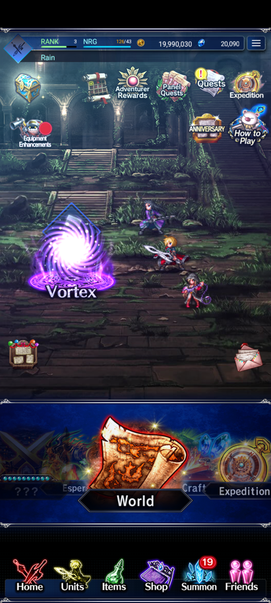
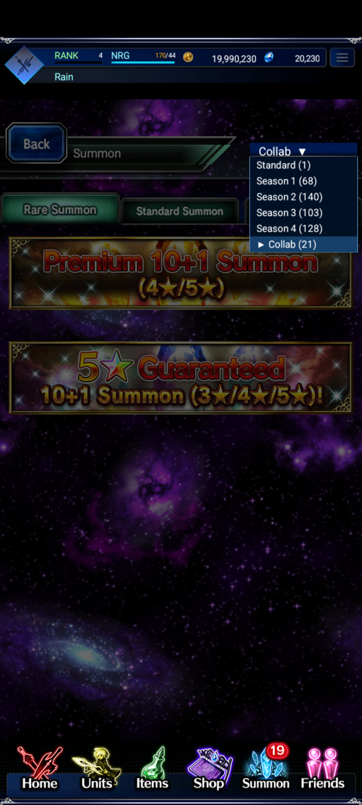
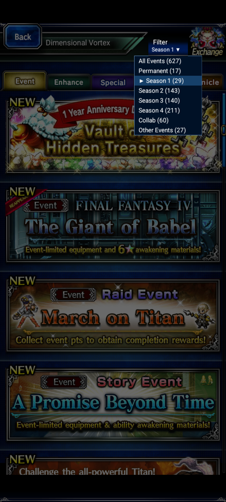

# Exvius Offline

**Play Final Fantasy Brave Exvius offline on Android.**

**[Download the APK (74 MB)](https://github.com/Elvlin/exvius-offline/raw/refs/heads/main/release/exvius-offline-v0.1.1.apk)**

This is a fan project built from the original Global game. Download the game data once, then play without the old servers. Your save stays on your phone.

Replay quests to farm Lapis, pick the summon season you want, and revisit events without waiting for them to return.

This project is still being worked on. It is unofficial and is not affiliated with Square Enix or gumi.

## Screenshots

| Home | Choose a summon season | Choose an event season |
| :---: | :---: | :---: |
|  |  |  |

## What changed from the online game?

### You can farm Lapis by replaying quests

Quest objectives that award Lapis can pay out again when you replay the stage and meet those objectives again. For example, if a quest gives Lapis for clearing it without using an item, you can earn that Lapis again on another successful run.

Other first-clear rewards, such as equipment, units and tickets, stay one-time. Normal battle drops still work as usual. This gives you a way to keep earning Lapis for summons without a cash shop.

### You choose which summon banners to browse

The dropdown at the top of **Summon** lets you pick **Standard, Season 1, Season 2, Season 3, Season 4 or Collab**. Choose a group, then use the Rare Summon, Standard Summon and Limited Time tabs to find its banners.

Seasons group banners by when they came out. Collab groups crossover banners by series. Changing this selection does not reset your story progress or start a new save.

Banner prices, featured units, tickets, step-ups and guarantees are kept where their original details are known. Some missing campaign details use replacements. You can check the current pool and rates through the banner's **Drop Rates** button.

### Events are available outside their old dates

Open **Vortex** and use **Filter** to choose **All Events, Permanent, Season 1, Season 2, Season 3, Season 4, Collab or Other Events**. You can browse different eras without waiting for an event to return on the calendar.

The summon dropdown and Vortex filter are separate. You can browse one season's summons and another season's events on the same save.

### Raids are adjusted for solo play

You no longer need a whole server of players to push the raid forward. The shared raid progress is adjusted for one player. The original bosses, battle stats and personal point reward targets are kept; this change is to the shared progress, rather than a blanket reduction in enemy difficulty.

### Former cash bundles cost Lapis

Bundles that used to cost real money are bought with Lapis. There is also a **2,000 Friend Points** bundle for **100 Lapis**.

Daily login rewards use your local save and date. You do not need to sign into an online account to collect them.

### What about balance?

The main changes are repeatable Lapis rewards, Lapis prices for former cash bundles, and raid progress that one player can complete. Units, enemies and summon prices have not all been given a blanket buff or discount. Original values are used where they are known, with replacements where details could not be recovered.

You still build a party, earn rewards, spend currency and upgrade units through the game's menus.

## Install

1. [Download the APK](https://github.com/Elvlin/exvius-offline/raw/refs/heads/main/release/exvius-offline-v0.1.1.apk) from the [release folder](release/).
2. Install it on an **Android 7.0 or newer phone with 64-bit ARM support**.
3. Open it with an internet connection. The app downloads all the game data automatically, about **14.5 GB**. Allow about **18 GB of free space** for setup.
4. Once setup is done, you can play offline.

If the download stops, reopen the app to continue. You do not have to choose or download chapters separately.

To update, install the newer APK over the existing app. **Uninstalling the app can erase your save.**

## Updates and offline play

When you open the app online, it checks GitHub for updates. If there is nothing new, it uses the files already on your phone. If you are offline, it skips the check and uses your downloaded data.

Changed data downloads in the background and is installed after you close and reopen the app. Existing data is reused across app updates. Android will ask you to confirm an APK update.

The repository is currently private for review. Downloads will be available without a GitHub login once it is made public.

## Still being worked on

Some advanced upgrades and event interactions still need fixes. Loading can also be slow on some devices. Restored text, artwork and events may have mistakes, so please report anything you find.

Saves are local. They do not connect to an official account or sync between devices. Real-money purchases and live multiplayer services are not available.

To report a problem, [open an issue](https://github.com/Elvlin/exvius-offline/issues). Tell me which screen or quest you were on, what you tried and what happened. A screenshot helps.

## Support or get in touch

If you would like to support the project, you can find me on [Ko-fi](https://ko-fi.com/elvlin) or [Patreon](https://www.patreon.com/c/ElvlinGame).

You can also contact me there if you have a project request or an idea you want to discuss. Donations are optional.

## Files in this repository

- [source/](source/): the code and build instructions.
- [release/](release/): the APK, screenshots and release notes.
- [data/](data/): information about the downloadable game data.

The APK is in the release folder. The large game data packs are in GitHub Releases and download automatically when you first open the app.

## Credits

Final Fantasy Brave Exvius and its original characters, artwork, music and other game content belong to their respective owners, including Square Enix and gumi. This is an unofficial fan project.
