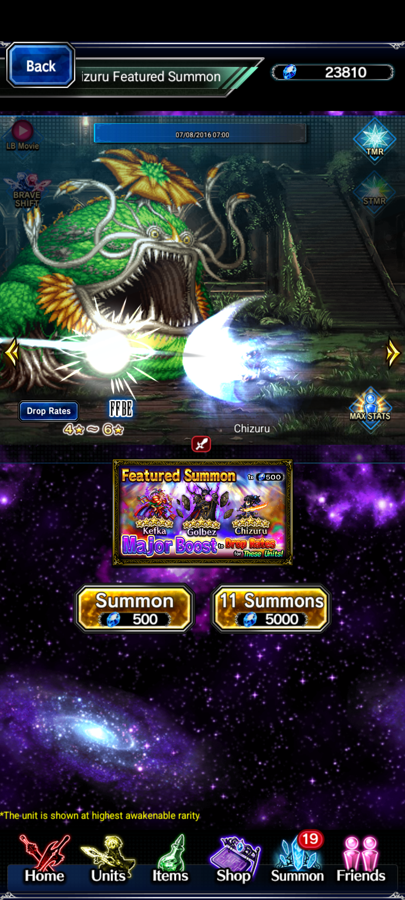
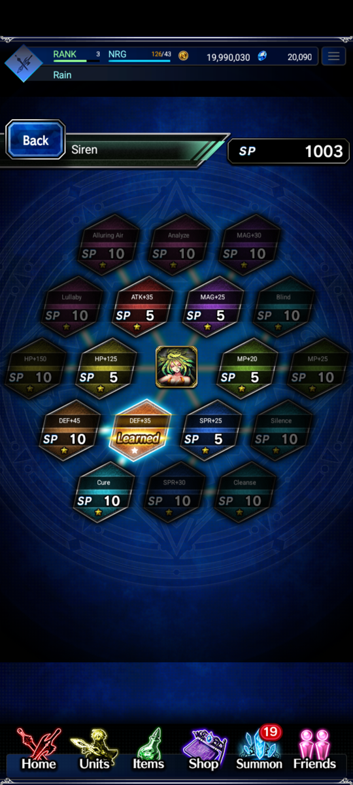

# Exvius Offline

A fan-made preservation project that brings **Final Fantasy Brave Exvius** to offline play using the original Global game client.

Download the game data once, then play on your device without the retired game servers. Your progress is saved locally. An internet connection is only needed for the initial download and to receive updates.

**This is an unofficial fan project. It is not affiliated with or endorsed by Square Enix or gumi.**

## A look inside

| Home | Summons | Esper training |
| :---: | :---: | :---: |
|  |  |  |

## What this project changes

- Replaces the retired server connection with game logic running on your device.
- Saves your campaign, units, inventory and progress locally.
- Makes the preserved story, explorations, towns and event content available through the original game interface.
- Adapts summons, shops, crafting, raids and other supported systems for local play.
- Lets you browse preserved summon and event content outside its original calendar dates.
- Repairs missing artwork, text, menu interactions and compatibility problems as development continues.
- Separates the app from the game data, so an app update does not require downloading every game file again.

This is an active preservation project, not a finished replacement for every feature of the online service. Some advanced systems and event interactions are still being completed. Official accounts, purchases and online services are not restored.

## Install and play

1. Open [Releases](https://github.com/Elvlin/exvius-offline/releases) and download the latest **Exvius Offline APK**.
2. Install it on an **Android 7.0 or newer, 64-bit ARM device**.
3. Open the app while connected to the internet. It downloads and installs the complete game data automatically. The current download is about **14.4 GB**; allow around **18 GB of free space** for installation.
4. Once setup finishes, play offline. There is no chapter-by-chapter download or separate data selection to manage.

If a download is interrupted, reopen the app to continue. Completed data parts are retained. Your save is kept when installing an app update over the existing installation. **Uninstalling the app can erase your local save.**

## Updates

When you open the app with an internet connection, it checks a small version file on GitHub. If nothing changed, it continues using the installed data. Without a connection, it uses the data already on your device.

New data downloads in the background and is installed when the app next starts after being closed. It does not replace files while you are playing. Only changed data parts need to be downloaded again. App updates use Android's normal installation confirmation. No GitHub account is needed once the downloads are publicly available.

## Current limitations

- This preview is still in development. Some advanced upgrades and archived event interactions need more work.
- Loading can be slow on some devices.
- Content is limited to the game files that have been preserved and restored.
- Local saves do not sync with an official account or another device.

Found a problem? Please [open an issue](https://github.com/Elvlin/exvius-offline/issues) with the screen or quest name, what you did, and what happened. Screenshots help.

## Support and project requests

If you enjoy the project and would like to support its development, you can find me here:

- **[Support me on Ko-fi](https://ko-fi.com/elvlin)**
- **[Support me on Patreon](https://www.patreon.com/c/ElvlinGame)**

Have a project request or an idea you would like to discuss? You can also contact me through Ko-fi or Patreon. Support is optional and helps me keep working on this project and other mods.

## Repository contents

| Folder | Contents |
| --- | --- |
| [`source/`](source/) | Offline adaptation source code and build instructions. |
| [`release/`](release/) | Release information, screenshots and APK download links. |
| [`data/`](data/) | Data version information and links to the complete downloadable data set. |

The APK and large data files are attached to GitHub Releases. They are kept outside Git history so the source repository stays manageable.

## Credits

Final Fantasy Brave Exvius, its characters, artwork, music and other original game content belong to their respective owners, including Square Enix and gumi. This project is a fan-made offline adaptation for preservation. It does not grant rights to the original game content.
